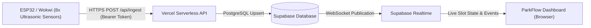

# ParkFlow | Real-Time Smart Parking Dashboard

[](https://vercel.com)
[](https://supabase.com)
[](https://wokwi.com)
[](LICENSE)

An intelligent, production-ready IoT smart parking system featuring live 8-slot occupancy detection, real-time WebSocket state streaming, gate status monitoring, slot allocation engine, and cloud ingestion API deployed seamlessly on **Vercel** with **Supabase**.

---

## 🏗️ Architecture



---

## ⚡ Quick Start: Deploy to Vercel

### 1. One-Click Import
1. Push this repository to GitHub: `https://github.com/insvk/CAPSTONE-SSE`.
2. Go to [Vercel Dashboard](https://vercel.com/new).
3. Import the `CAPSTONE-SSE` repository.
4. Leave framework as **Other** (it will auto-detect `package.json` and `vercel.json`).

### 2. Configure Environment Variables in Vercel
Add the following in **Settings > Environment Variables**:

| Variable Name | Description | Example |
|---|---|---|
| `SUPABASE_URL` | Your Supabase project URL | `https://xyzcompany.supabase.co` |
| `SUPABASE_ANON_KEY` | Public Anon key (used by frontend dashboard) | `eyJhbGci...` |
| `SUPABASE_SERVICE_ROLE_KEY` | Secret Service Role key (used only by `/api/ingest`) | `eyJhbGci...` |
| `DEVICE_INGEST_TOKEN` | Secret Bearer token for ESP32 / Wokwi authentication | `generate with: openssl rand -hex 32` |

### 3. Deploy
Click **Deploy**! Once completed, your dashboard and ingestion API endpoints are immediately live at `https://your-project.vercel.app`.

---

## 📡 API Endpoints

### `POST /api/ingest`
Receives live telemetry from ESP32 / Wokwi.
- **Headers:**
  - `Content-Type: application/json`
  - `Authorization: Bearer <DEVICE_INGEST_TOKEN>`
- **Payload:**
  ```json
  {
    "device_id": "esp32-node-01",
    "slot_id": "S1",
    "distance_cm": 24.5,
    "occupied": true,
    "sensor_ok": true
  }
  ```
- **Response:**
  ```json
  { "ok": true, "slot_id": "S1", "recorded_at": "2026-10-29T16:20:00.000Z" }
  ```

### `GET /api/config`
Safely delivers public client keys (`SUPABASE_URL`, `SUPABASE_ANON_KEY`) to the dashboard without exposing any backend secrets.

### `GET /api/health`
Health check endpoint reporting API status and uptime.

---

## 🛠️ Local Development

```bash
# 1. Install dependencies
npm install

# 2. Copy environment template
cp .env.example .env
# Fill in your Supabase credentials and tokens

# 3. Start local development server
npm run dev
# or: npx vercel dev
```

---

## 📖 Comprehensive Setup Guide
See [SETUP_GUIDE.md](SETUP_GUIDE.md) for full instructions on Supabase table creation, real-time publication setup, Row Level Security (RLS), and ESP32 hardware wiring.
