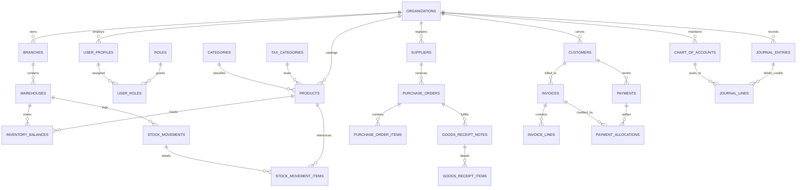

# Database Design & Schema Reference: CSA0201-B-CAPSTONE-IMBS

**Project Title:** High-Performance Enterprise Inventory Management & Billing System  
**Canonical Identity:** `CSA0201-B-CAPSTONE-IMBS`  
**Database Engine:** PostgreSQL 16 / Supabase Enterprise  
**Precision Convention:** Fixed-point integer minor units (`BIGINT` paise/cents), basis points (`INTEGER` 10000 = 100.00%)  
**Revision:** Version 1.0 (Academic Capstone Defense Edition)

---

## 1. Overview & Relational Strategy

The relational architecture of `CSA0201-B-CAPSTONE-IMBS` is engineered to enforce financial integrity, non-repudiation, and microsecond-level query performance. It adheres strictly to Third Normal Form (3NF) for transactional operational tables and leverages append-only ledgers for stock movements and double-entry accounting journals.

### Key Architectural Tenets:
1. **Integer Financials:** All monetary amounts are stored as `BIGINT` representing minor units (cents/paise), eliminating IEEE 754 floating-point inaccuracies.
2. **Basis Point Precision:** All percentages (GST tax rates, line discounts, invoice-level markdowns) are stored as `INTEGER` basis points where $10000 = 100.00\%$.
3. **Immutable Ledgers:** Inventory balances are reconciled against an immutable ledger (`stock_movements`), ensuring that physical stock can always be mathematically reconstructed from historical movements.
4. **Row-Level Security (RLS):** Built-in multi-tenant isolation ensures data isolation across organizations and branches.

---

## 2. Entity-Relationship Model



---

## 3. Data Dictionary

### 3.1. Tenant & Organization Hierarchy

#### `organizations`
Defines top-level tenant boundaries.
| Column | Type | Constraints | Description |
|---|---|---|---|
| `id` | `UUID` | `PRIMARY KEY, DEFAULT gen_random_uuid()` | Unique tenant identifier |
| `name` | `VARCHAR(255)` | `NOT NULL` | Registered legal enterprise name |
| `legal_name` | `VARCHAR(255)` | `NULL` | Formal business registration name |
| `tax_identifier` | `VARCHAR(50)` | `NOT NULL, UNIQUE` | GSTIN / PAN / Federal Tax ID |
| `currency_code` | `VARCHAR(3)` | `NOT NULL, DEFAULT 'INR'` | ISO 4217 Currency Code (INR, USD, EUR) |
| `created_at` | `TIMESTAMPTZ` | `NOT NULL, DEFAULT NOW()` | Record creation timestamp |
| `updated_at` | `TIMESTAMPTZ` | `NOT NULL, DEFAULT NOW()` | Record update timestamp |

#### `branches`
Physical or regional operating branches of an organization.
| Column | Type | Constraints | Description |
|---|---|---|---|
| `id` | `UUID` | `PRIMARY KEY, DEFAULT gen_random_uuid()` | Unique branch identifier |
| `organization_id` | `UUID` | `NOT NULL, REFERENCES organizations(id)` | Parent organization |
| `code` | `VARCHAR(50)` | `NOT NULL` | Branch code (e.g., `BR-HQ`, `BR-NORTH`) |
| `name` | `VARCHAR(255)` | `NOT NULL` | Branch public name |
| `state_code` | `VARCHAR(10)` | `NOT NULL` | 2-digit GST state code (e.g., `27` for Maharashtra, `29` for Karnataka) |
| `is_active` | `BOOLEAN` | `NOT NULL, DEFAULT true` | Active operating flag |

#### `warehouses`
Storage facilities and retail checkout locations within branches.
| Column | Type | Constraints | Description |
|---|---|---|---|
| `id` | `UUID` | `PRIMARY KEY, DEFAULT gen_random_uuid()` | Unique warehouse identifier |
| `branch_id` | `UUID` | `NOT NULL, REFERENCES branches(id)` | Parent branch |
| `code` | `VARCHAR(50)` | `NOT NULL` | Warehouse code (e.g., `WH-MAIN`, `WH-POS1`) |
| `name` | `VARCHAR(255)` | `NOT NULL` | Warehouse name |
| `is_primary` | `BOOLEAN` | `NOT NULL, DEFAULT false` | Primary fulfillment warehouse flag |

---

### 3.2. Product & Inventory Catalog

#### `products`
Master catalog of sellable and raw items.
| Column | Type | Constraints | Description |
|---|---|---|---|
| `id` | `UUID` | `PRIMARY KEY, DEFAULT gen_random_uuid()` | Product identifier |
| `organization_id` | `UUID` | `NOT NULL, REFERENCES organizations(id)` | Tenant reference |
| `sku` | `VARCHAR(100)` | `NOT NULL` | Stock Keeping Unit (alphanumeric uppercase) |
| `barcode` | `VARCHAR(100)` | `NULL, UNIQUE` | EAN-13, UPC-A, or internal barcode |
| `name` | `VARCHAR(255)` | `NOT NULL` | Product descriptive name |
| `category_id` | `UUID` | `NOT NULL, REFERENCES categories(id)` | Merchandise category |
| `tax_category_id` | `UUID` | `NOT NULL, REFERENCES tax_categories(id)`| HSN code and GST rate mapping |
| `base_uom` | `VARCHAR(10)` | `NOT NULL, DEFAULT 'PCS'` | Base Unit of Measure (PCS, BOX, KG, L) |
| `purchase_price` | `BIGINT` | `NOT NULL, CHECK (purchase_price >= 0)` | Standard purchase price in minor units |
| `selling_price` | `BIGINT` | `NOT NULL, CHECK (selling_price >= 0)` | Retail selling price in minor units |
| `reorder_point` | `BIGINT` | `NOT NULL, DEFAULT 10` | Low-stock notification trigger quantity |
| `is_active` | `BOOLEAN` | `NOT NULL, DEFAULT true` | Active catalog status |

#### `inventory_balances`
Real-time physical stock snapshot per product and warehouse.
| Column | Type | Constraints | Description |
|---|---|---|---|
| `id` | `UUID` | `PRIMARY KEY, DEFAULT gen_random_uuid()` | Balance record ID |
| `warehouse_id` | `UUID` | `NOT NULL, REFERENCES warehouses(id)` | Storage location |
| `product_id` | `UUID` | `NOT NULL, REFERENCES products(id)` | Product reference |
| `quantity_on_hand` | `BIGINT` | `NOT NULL, CHECK (quantity_on_hand >= 0)`| Physical units physically present |
| `quantity_reserved`| `BIGINT` | `NOT NULL, CHECK (quantity_reserved >= 0)`| Units allocated to active orders |
| `weighted_avg_cost`| `BIGINT` | `NOT NULL, CHECK (weighted_avg_cost >= 0)`| Unit WAC in minor units |
| `updated_at` | `TIMESTAMPTZ` | `NOT NULL, DEFAULT NOW()` | Last movement synchronization |

#### `stock_movements` & `stock_movement_items`
Immutable ledger of all stock transitions (IN, OUT, TRANSFER, ADJUST, RETURN).
- `stock_movements`: Movement headers tracking movement type, source/destination warehouses, and reference document numbers.
- `stock_movement_items`: Movement lines tracking exact quantity delta, unit cost, and pre/post movement quantity snapshots.

---

### 3.3. Billing, Invoices & POS

#### `invoices`
Tax invoices generated via POS or back-office sales.
| Column | Type | Constraints | Description |
|---|---|---|---|
| `id` | `UUID` | `PRIMARY KEY, DEFAULT gen_random_uuid()` | Invoice ID |
| `organization_id` | `UUID` | `NOT NULL, REFERENCES organizations(id)` | Organization owner |
| `branch_id` | `UUID` | `NOT NULL, REFERENCES branches(id)` | Issuing branch |
| `customer_id` | `UUID` | `NULL, REFERENCES customers(id)` | Customer (nullable for walk-in cash sales) |
| `invoice_number` | `VARCHAR(100)` | `NOT NULL, UNIQUE` | Sequential invoice series (e.g., `INV-2026-0001`)|
| `invoice_date` | `DATE` | `NOT NULL, DEFAULT CURRENT_DATE` | Date of billing |
| `subtotal` | `BIGINT` | `NOT NULL, CHECK (subtotal >= 0)` | Sum of gross line amounts before tax |
| `discount_amount`| `BIGINT` | `NOT NULL, DEFAULT 0` | Total promotional discount applied |
| `tax_amount` | `BIGINT` | `NOT NULL, DEFAULT 0` | Aggregated GST (CGST+SGST or IGST) |
| `round_off` | `BIGINT` | `NOT NULL, DEFAULT 0` | Mathematical cash round-off adjustment |
| `grand_total` | `BIGINT` | `NOT NULL, CHECK (grand_total >= 0)`| Net payable amount |
| `paid_amount` | `BIGINT` | `NOT NULL, DEFAULT 0` | Cumulative settled payments |
| `balance_due` | `BIGINT` | `NOT NULL, CHECK (balance_due >= 0)` | Outstanding accounts receivable balance |
| `status` | `VARCHAR(20)` | `NOT NULL, DEFAULT 'UNPAID'` | `UNPAID`, `PARTIALLY_PAID`, `PAID`, `CANCELLED` |

#### `invoice_lines`
Individual line items on an invoice.
| Column | Type | Constraints | Description |
|---|---|---|---|
| `id` | `UUID` | `PRIMARY KEY, DEFAULT gen_random_uuid()` | Line ID |
| `invoice_id` | `UUID` | `NOT NULL, REFERENCES invoices(id) ON DELETE CASCADE` | Parent invoice |
| `product_id` | `UUID` | `NOT NULL, REFERENCES products(id)` | Sold product |
| `quantity` | `BIGINT` | `NOT NULL, CHECK (quantity > 0)` | Sold quantity |
| `unit_price` | `BIGINT` | `NOT NULL, CHECK (unit_price >= 0)` | Unit selling price in minor units |
| `discount_bps` | `INTEGER` | `NOT NULL, DEFAULT 0` | Line discount in basis points |
| `tax_rate_bps` | `INTEGER` | `NOT NULL, DEFAULT 0` | Applicable GST rate in basis points |
| `cgst_amount` | `BIGINT` | `NOT NULL, DEFAULT 0` | Central GST amount |
| `sgst_amount` | `BIGINT` | `NOT NULL, DEFAULT 0` | State GST amount |
| `igst_amount` | `BIGINT` | `NOT NULL, DEFAULT 0` | Integrated GST amount |
| `line_total` | `BIGINT` | `NOT NULL, CHECK (line_total >= 0)` | Final net line total including tax |

---

### 3.4. Double-Entry Accounting Architecture

#### `chart_of_accounts`
Master hierarchy of financial accounts.
- Account Types: `ASSET`, `LIABILITY`, `EQUITY`, `REVENUE`, `EXPENSE`.
- Core Standard Codes:
  - `1010`: Cash in Register (Asset)
  - `1020`: Bank Current Account (Asset)
  - `1110`: Accounts Receivable (Asset)
  - `1210`: Merchandise Inventory Asset (Asset)
  - `2010`: Accounts Payable (Liability)
  - `2110`: Output CGST Payable (Liability)
  - `2120`: Output SGST Payable (Liability)
  - `2130`: Output IGST Payable (Liability)
  - `4010`: Sales Revenue (Revenue)
  - `5010`: Cost of Goods Sold (Expense)

#### `journal_entries` & `journal_lines`
Immutable financial accounting journal.
- Enforces invariant: $\sum \text{Debit Amounts} = \sum \text{Credit Amounts}$.
- Validated prior to database write by C domain engine (`accounting.c`).

---

## 4. Key Database Constraints & Performance Indexes

### 4.1. Financial Check Constraints
```sql
ALTER TABLE inventory_balances 
  ADD CONSTRAINT chk_inv_qty_positive CHECK (quantity_on_hand >= 0),
  ADD CONSTRAINT chk_inv_res_positive CHECK (quantity_reserved >= 0),
  ADD CONSTRAINT chk_inv_wac_positive CHECK (weighted_avg_cost >= 0);

ALTER TABLE invoices
  ADD CONSTRAINT chk_inv_subtotal_pos CHECK (subtotal >= 0),
  ADD CONSTRAINT chk_inv_grand_total_pos CHECK (grand_total >= 0),
  ADD CONSTRAINT chk_inv_balance_due_pos CHECK (balance_due >= 0);

ALTER TABLE journal_lines
  ADD CONSTRAINT chk_jl_amounts_positive CHECK (debit_amount >= 0 AND credit_amount >= 0),
  ADD CONSTRAINT chk_jl_debit_xor_credit CHECK ((debit_amount > 0 AND credit_amount = 0) OR (credit_amount > 0 AND debit_amount = 0));
```

### 4.2. High-Throughput Indexes
```sql
CREATE INDEX idx_products_sku ON products(organization_id, sku);
CREATE INDEX idx_products_barcode ON products(organization_id, barcode) WHERE barcode IS NOT NULL;
CREATE INDEX idx_inv_bal_wh_prod ON inventory_balances(warehouse_id, product_id);
CREATE INDEX idx_stock_mov_date ON stock_movements(organization_id, movement_date DESC);
CREATE INDEX idx_invoices_lookup ON invoices(organization_id, invoice_number);
CREATE INDEX idx_invoices_date ON invoices(organization_id, invoice_date DESC);
CREATE INDEX idx_journal_lines_acc ON journal_lines(account_id);
```

---
*End of Database Design Specification.*

